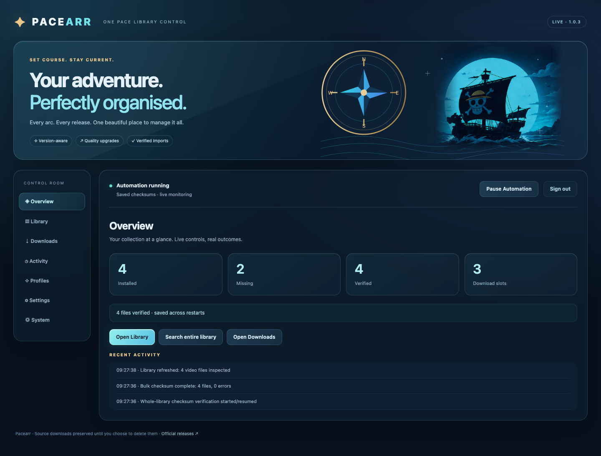
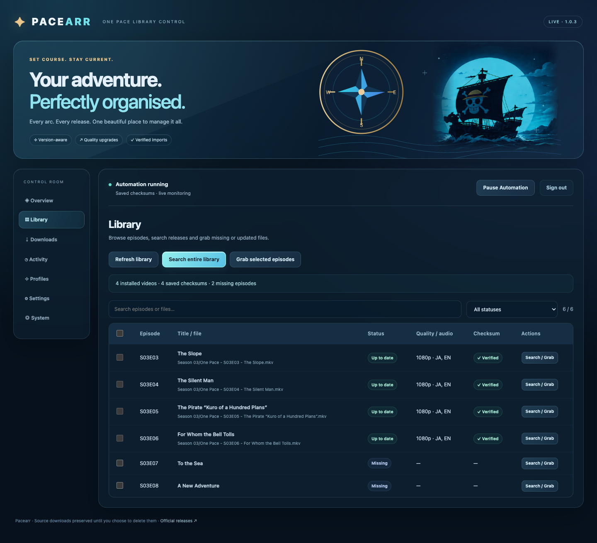
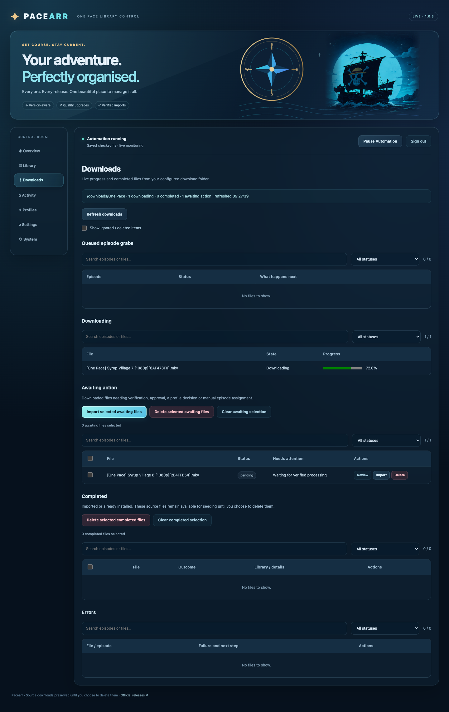
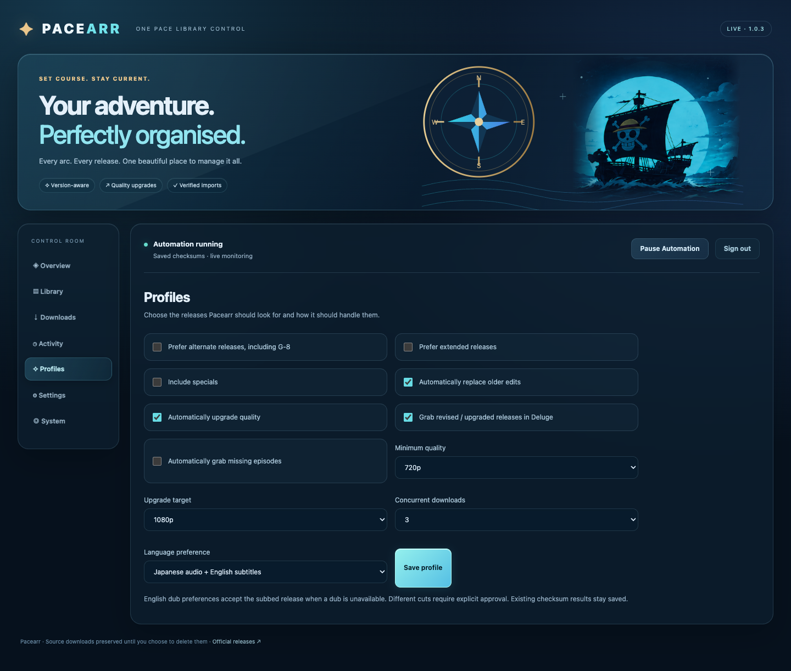
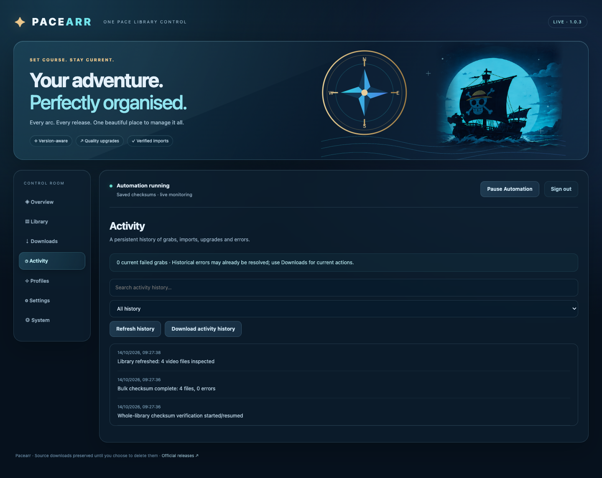

<p align="center">
  
</p>

# Pacearr

**One Pace library automation, built for self-hosters.**

[](https://github.com/DaHeroKozuki/Pacearr/releases)
[](https://github.com/DaHeroKozuki/Pacearr/pkgs/container/pacearr)
[](https://github.com/DaHeroKozuki/Pacearr/releases)
[](https://github.com/DaHeroKozuki/Pacearr/issues)
[](https://github.com/DaHeroKozuki/Pacearr/commits/main)
[](LICENSE)

Pacearr is a self-hosted One Pace library manager that discovers releases, watches downloads, verifies completed files and keeps your collection current—with a glass-style WebUI that puts you in control.

Originally derived from [OnePacerr](https://github.com/eltharynd/OnePacerr), Pacearr has grown from a reliability-focused fork into a library manager with persistent settings, release profiles, real-time views and verified imports.

> **One Pace. Managed.** From your first missing episode to the next re-edited release—see what Pacearr is doing, choose what happens next, and let verified automation handle the routine work.

<p align="center"><a href="https://github.com/DaHeroKozuki/Pacearr/releases/latest"><b>Download the latest release</b></a> · <a href="https://github.com/DaHeroKozuki/Pacearr/pkgs/container/pacearr"><b>Get the Docker image</b></a> · <a href="https://discord.gg/u3zksrG8G6"><b>Join the community</b></a></p>



*Screenshots use an isolated demonstration library, not a user's private configuration or media.*

## Table of contents

- [What Pacearr does](#what-pacearr-does)
- [See the WebUI](#see-the-webui)
- [Current capabilities](#current-capabilities)
- [How an episode reaches your library](#how-an-episode-reaches-your-library)
- [Quality, language and release profiles](#quality-language-and-release-profiles)
- [Compatibility](#compatibility)
- [Getting started](#getting-started)
- [Mounts and permissions](#mounts-and-permissions)
- [Configuration reference](#configuration-reference)
- [Reliability and recovery](#reliability-and-recovery)
- [Updates, migration and cleanup](#updates-migration-and-cleanup)
- [The journey so far](#the-journey-so-far)
- [Historical Alpha engine and configuration](#historical-alpha-engine-and-configuration)
- [Origins and attribution](#origins-and-attribution)
- [Contributing](#contributing)
- [Credits and acknowledgements](#credits-and-acknowledgements)
- [License and disclaimer](#license-and-disclaimer)

## What Pacearr does

One Pace is structured around arcs, cuts and revised releases—not conventional broadcast episodes. Pacearr connects authoritative Beta episode mapping with the [One Pace release page](https://onepace.net/en/releases), Deluge completion data and your actual library files.

It helps you answer: What do I already have? What is missing? Is this the same file, a better-quality release or a newer edit? What is downloading? Why is something waiting? The interface brings those decisions together without requiring you to manage every import from a terminal.

Pacearr imports verified releases into season/episode filenames, keeps original source downloads for seeding and preserves replaced files as backups. Quality upgrades and same-cut revisions can run unattended; unsupported files remain visible for explicit review and manual assignment.

## See the WebUI

### Library — your collection, release by release

Browse installed and missing episodes, filter statuses, see saved checksum results, and search one episode, selected episodes or the full library. New imports appear automatically; the Overview counts follow the same refreshed inventory.



### Downloads — watch progress and take action

A live feed shows progress for the exact download folder you configured. Awaiting action holds downloaded files needing verification, approval or manual assignment. Completed holds imported or already installed sources, with separate selection and deletion controls. Select several files for bulk import or confirmed deletion; inspect unresolved cases instead of guessing what happened.



### Profiles — choose the collection you want

Set minimum quality, an upgrade target, preferred cuts, language preference and download concurrency. Turn automatic revisions, quality upgrades and missing-episode grabs on or off independently.



<details><summary><b>Activity — the story behind every action</b></summary>



Activity shows current failed-grab counts separately from history, offers severity filtering, and records Deluge RPC methods, redacted rejection details and retry timing. It stores the latest 1,000 timestamped entries across restarts: checksums, imports, upgrades, review decisions, errors and recovery. Search it or export a text log.

</details>

## Current capabilities

| Area | What you can do |
| --- | --- |
| Overview | See installed/missing/verified counts, download capacity and recent activity |
| Library | Inspect episodes, saved checksums and available release updates |
| Search & grabs | Search the whole collection, selected episodes or a single release; submit selected magnets to Deluge |
| Automation | Start/pause automatic imports and configured revision/upgrade acquisition |
| Downloads | Watch scoped torrent progress; review, recheck, ignore, import or delete completed files |
| Manual imports | Assign unsupported cuts to authoritative episode targets, singly or in bulk |
| Profiles | Prefer standard/extended/alternate cuts, 720p/1080p targets and simple audio/subtitle preferences |
| Activity | Search persistent outcomes and export history |
| Settings | Manage paths, private-network connection settings and encrypted credentials |
| System | Check saved paths, reuse checksum records and open project/community links |

The UI checks for changes every five seconds. Library refresh follows recorded changes and also periodically checks for externally added files. Downloads progress refreshes while its tab is open. Existing searches/selections stay available, and polling does not replace text you are editing in Settings.

## How an episode reaches your library

```text
Current release metadata → profile decision → Deluge grab
                                               ↓
                                   torrent + file completion
                                               ↓
                             path / size / CRC32 / media checks
                                               ↓
                         verified copy → season/episode library file
                                               ↓
                              saved identity + activity + UI refresh
```

1. Pacearr maps current releases to season/episode identities using Beta metadata. Official hash-linked release details supply resolution, audio and subtitles where available.
2. Grabs use your saved download folder. Existing torrent hashes are checked globally to avoid adding the same torrent again. The concurrency limit includes active downloads already in that folder.
3. Import waits for complete torrent and file progress, exact path/size and a regular file within the configured folder. An incomplete or mismatched download cannot pass through automatically.
4. Computed CRC32 must match authoritative release identity. CRC32 is a content identity marker, not cryptographic proof of authenticity; a bracketed CRC in a filename alone is not enough.
5. A copy is staged and verified before it becomes a library file. Upgrades preserve the old file and record a recovery journal. Sources remain in Downloads for seeding.
6. Unsupported custom cuts require your episode assignment. Manual assignment is recorded separately from an official release identity; it does not invent authoritative metadata.

**Review is actionable:** inspect the reason, recheck it, ignore a file/folder or assign and import it. Different cuts, conflicting installed copies and unknown identities require attention. Retry rechecks Pacearr work; underlying Deluge download problems must first be fixed in Deluge.

**Deletion is explicit:** single/bulk deletion previews selected completed source files. Library copies are preserved. An optional torrent-record removal always requests `remove_data=false`; unselected files remain on disk. Deleting source files affects seeding. Pause automation and wait for current file operations before deleting.

## Quality, language and release profiles

- **Quality:** the default minimum is 720p and upgrade target is 1080p. Verified upgrades can replace lower-quality installed files; automatic downgrades are blocked.
- **Revisions:** a newly published edit with a new authoritative identity is a new release even at the same resolution. Matching current bytes are skipped.
- **Cuts:** enabled alternate/extended preferences follow Beta precedence. Automatic revisions stay within the same cut; switching cuts requires explicit selection/approval.
- **Language:** Subbed means Japanese audio with English subtitles; Dubbed prefers English audio; Both prefers English and Japanese audio plus English subtitles. Dubbed/Both accept an English-subbed fallback when a dub is unavailable. Bundled tracks are inspected together—no separate dub download is required.
- **Missing episodes:** automatic missing-episode grabs are optional. Manual searches/grabs remain available while unattended automation is paused.
- **Concurrency:** default three active downloads, adjustable from one to ten.

## Compatibility

| Integration | Current v1 WebUI runtime | Earlier Alpha / OnePacerr engine |
| --- | --- | --- |
| Deluge | Live feed, authoritative grabs, completed-file import and explicit record removal | Available |
| Mounted library folders | Verified imports, upgrade backups, inventory and checksums | Available |
| Plex | Read-only connection tests and library discovery; Plex mutations/scans disabled | Metadata/poster updates and scan handling |
| Jellyfin / Emby | Not enabled in the current runtime | Historical implementation retained |
| qBittorrent / Transmission / µTorrent | Not enabled in the current runtime | Historical implementation retained |
| Posters / sidecar metadata | Historical artwork/source retained; no new automatic poster mutations | Historical implementation retained |

The older implementation and configuration details remain in the repository and the historical section below. The public v1 Docker image runs `server.mjs`; it does not start the earlier TypeScript engine in `src/`.

Docker images support **linux/amd64** and **linux/arm64**. Node.js 24 and ffmpeg/ffprobe are included. Docker is the recommended installation; local development is also supported.

## Getting started

### Prerequisites

- Docker and Docker Compose.
- Deluge with its Web API reachable on a private-network HTTP IP address.
- A mounted, writable One Pace library folder and readable completed-download folder.
- A persistent state folder owned by the user/group running the container.

### Docker Compose

Use `ghcr.io/daherokozuki/pacearr:latest` for updates, or pin a published version. The examples below are portable defaults—not a particular user's installation.

Create a deployment folder anywhere you prefer. Place `compose.yaml` and a private `.env` there:

```sh
mkdir -p /path/to/pacearr/data/state
cd /path/to/pacearr
cp /path/to/downloaded/.env.example .env
```

Edit `.env` with your host's user/group IDs and folders:

```dotenv
PUID=1000
PGID=1000
WEB_PORT=3000
LIBRARY_DIR=/path/to/one-pace-library
DOWNLOADS_DIR=/path/to/downloads
```

`1000:1000` is an example, not an instruction to use that account on every host. Run `id your-service-user` to find suitable IDs. Choose any free host port; the internal port stays `3000`. Paths on the left of a volume mapping belong to your host.

```yaml
services:
  pacearr:
    image: ghcr.io/daherokozuki/pacearr:latest
    container_name: pacearr
    restart: unless-stopped
    user: "${PUID:-1000}:${PGID:-1000}"
    read_only: true
    security_opt:
      - no-new-privileges:true
    cap_drop:
      - ALL
    ports:
      - "${WEB_PORT:-3000}:3000"
    environment:
      PACEARR_LIBRARY_ROOT: /library
      PACEARR_DOWNLOAD_ROOT: /downloads
    volumes:
      - ./data/state:/data/state
      - ${LIBRARY_DIR:?Set LIBRARY_DIR in .env}:/library:rw
      - ${DOWNLOADS_DIR:?Set DOWNLOADS_DIR in .env}:/downloads:rw
    tmpfs:
      - /tmp

```

Create a writable state directory owned by the chosen UID:GID, then start:

```sh
mkdir -p data/state
sudo chown -R 1000:1000 data/state  # Replace with your chosen UID:GID

docker compose -p pacearr --env-file .env -f compose.yaml pull pacearr
docker compose -p pacearr --env-file .env -f compose.yaml up -d pacearr
docker compose -p pacearr --env-file .env -f compose.yaml logs --tail 30 pacearr
```

Open **http://your-server:3000**, or substitute the `WEB_PORT` you chose. Create the administrator account and configure the mounted paths/connections in Settings.

### NAS and Synology installations

The same Compose file works on a NAS. Set your own host folders in `.env`, for example `LIBRARY_DIR=/volume1/path/to/one-pace-library` and `DOWNLOADS_DIR=/volume1/path/to/downloads`. Find a suitable NAS service account UID:GID; do not assume desktop Linux example IDs are correct. Older installations may use `docker-compose` instead of `docker compose`.

Choose any deployment folder you prefer. Its minimal layout is:

```text
pacearr/
├── compose.yaml
├── .env          ← your host paths, UID:GID and chosen WebUI port
└── data/
    └── state/    ← private settings, vault keys, checksums and history
```

Source, ZIPs, tests and Dockerfiles are not needed in a registry-image deployment.

### Recommended first run

1. Create the administrator account. Keep the service on your private network.
2. Save the container-visible library and exact One Pace download paths.
3. Save the Deluge connection/password; optionally test Plex and select libraries.
4. Test connections and saved-path access. Both services must agree on the download path.
5. Let the initial library checksum baseline finish. Existing valid records are reused.
6. Review quality/cut/language preferences, then use Start Automation. Pause during setup if needed; saved running/paused state persists.

### Running locally

```sh
npm test
npm run test:integration

PACEARR_STATE_DIR=./data/state \
PACEARR_WEB_DIR=./web \
PACEARR_LIBRARY_ROOT=/your/library \
PACEARR_DOWNLOAD_ROOT=/your/downloads \
npm start
```

Use Node.js 24 or later and install ffprobe for real media-track inspection. There are no npm runtime dependencies. Browser tests and screenshot capture additionally require Playwright and a Chromium installation; see Contributing.

## Mounts and permissions

| Mount | Purpose | Required access |
| --- | --- | --- |
| `./data/state:/data/state` | Settings, vault keys, encrypted secrets, CRC records, queues and Activity | Read/write; persistent across updates |
| Library root → `/library` (or your existing path) | Scan existing videos, create imported season/episode files and upgrade backups | Read/traverse and write |
| Downloads root → `/downloads` (or your existing path) | Read completed sources; explicitly delete selected files | Read/traverse; write required for deletion |
| `/tmp` tmpfs | Temporary process data in a read-only container | Writable tmpfs |

**The saved download path must match Deluge's reported absolute path.** For example, mount a host downloads directory at `/downloads` in both containers, set `PACEARR_DOWNLOAD_ROOT=/downloads`, and save `/downloads/One Pace` in Pacearr Settings. Configure the torrent client to use that same container-visible folder. Select the exact series subfolder, not the parent directory. Files in other folders are excluded.

If both services report different container paths for the same host directory, fix the volume destination before enabling automation. v1 currently expects matching absolute paths and does not infer a remote mapping from legacy variables.

Do not recursively change ownership of your whole media collection just to solve a state-folder permission issue. Grant the container user the permissions it needs to the configured folders; keep Plex/Deluge access compatible.

## Configuration reference

Routine settings are managed in the WebUI rather than `.env`. Runtime roots define where saved paths may point.

| Variable | Recommended starter configuration | Purpose |
| --- | --- | --- |
| `PORT` | `3000` | Internal HTTP port |
| `PACEARR_STATE_DIR` | `/data/state` | Persistent settings/vault/history directory |
| `PACEARR_WEB_DIR` | `/app/web` | Bundled WebUI assets |
| `PACEARR_LIBRARY_ROOT` | `/library` | Allowed library root; explicitly set by starter Compose |
| `PACEARR_DOWNLOAD_ROOT` | `/downloads` | Allowed download root; explicitly set by starter Compose |
| `PACEARR_FFPROBE` | `ffprobe` | Media inspection executable |

| WebUI setting | What it controls |
| --- | --- |
| Library path | The actual One Pace series folder, including existing season subfolders |
| Download path | The exact folder Pacearr displays and processes |
| Deluge URL/password | Private-network Web API and encrypted credential |
| Plex URL/token/libraries | Read-only connection/discovery selection |
| Automation | Start/pause automatic file processing and configured release acquisition |
| Profiles | Cut preferences, missing/revision/quality grabs, quality/language and concurrency |

Only private-network HTTP IP endpoints are currently accepted for Deluge/Plex connection tests. Public hosts, localhost and HTTPS endpoints are rejected by the current endpoint guard. Use the appropriate LAN IP, and ensure the container can reach it.

## Reliability and recovery

Verification is persistent. A saved CRC includes file size, modification/change timestamps and inode; unchanged records survive restarts and updates. New/changed files need fresh verification. The initial bulk job resumes interrupted work rather than discarding its progress.

Imports check authoritative identity, completion, path containment, size, CRC and media/profile criteria. Copies are staged, synced and verified before publication. Replacements preserve `.pacearr-backup-*` and save a journal for restart recovery. At least **2 GiB free library space beyond the copy** is required.

Failures use bounded retries/backoff and remain visible in Activity. Duplicate current bytes are skipped. Metadata caches persist for offline inventory; stale Beta metadata blocks new automatic acquisitions. Unsupported or ambiguous releases remain reviewable instead of being silently guessed.

Pausing stops the next automatic grab/import; an in-flight verified operation may finish. Explicit manual requests still run while automatic processing is paused. Original downloads are retained unless you explicitly delete them.

## Updates, migration and cleanup

### Normal registry updates

```sh
cd /path/to/pacearr
# Use `docker-compose` instead of `docker compose` on older Synology installations.
docker compose -p pacearr -f compose.yaml pull pacearr
docker compose -p pacearr -f compose.yaml up -d --no-build --no-deps --force-recreate pacearr
docker compose -p pacearr -f compose.yaml logs --tail 30 pacearr
```

Refresh the browser once to load updated application assets. Routine content changes then refresh automatically. Your library, downloads and `/data/state` stay in their bind-mounted folders.

### Existing deployments and cleanup

Keep your existing mount destinations and `/data/state` location when updating. Do not overwrite a working Compose file with example paths. Changing the application image does not migrate your host folders automatically.

If you want to change project/service/container names, the migration helper takes explicit deployment and old-name parameters; see its required variables before running it. It backs up configuration/state and checks the new container's health. No personal deployment paths are hard-coded.

The cleanup helper takes a deployment-directory argument and the container name. It archives unused development files outside that directory, retains `.env`, configuration/state and mounted files, and refuses unsupported additional Compose references. Read its output before removing backups.

GitHub contains application source and tests. **Private settings, vault keys, media and checksum records are not uploaded.** Verify the running state mount and keep a separate state backup before deleting any old deployment folder.

### Earlier Alpha / OnePacerr migrations

v1 does not silently migrate the earlier TypeScript `.env`/SQLite configuration. Existing OnePacerr/Alpha engine users should back up their state, configure the v1 WebUI and verify mounts/profiles. Standalone Phase 16–31 users keep their existing `setup.json`, vault keys and checksum records by retaining `/data/state` at the same location.

### Rollback

Stop the worker before restoring an earlier image or application. Avoid replacing current state with an older snapshot casually: it may discard recent verification, Activity or recovery journals. Restore upgraded media from the recorded `.pacearr-backup-*` while stopped. Deleted sources require a separate backup or redownload.

## The journey so far

| Milestone | What it brought |
| --- | --- |
| OnePacerr foundation | Release discovery, torrent clients, organization, posters and media-server integrations |
| Beta reliability work | Persistent processing state, retries, recovery and resilient Plex handling |
| Pacearr `0.1.0-alpha` | A distinct project identity with the original engine and history preserved |
| Standalone development | Administrator setup, encrypted settings, credential controls and read-only inventory |
| Engine integration | Authoritative release-to-episode mapping and verified Deluge completion |
| Library management | Library/download views, profiles, persisted checksums and Activity |
| Live automation | Verified imports, same-cut revisions, quality upgrades and explicit grabs |
| `1.0.0` | Public WebUI runtime, automatic refresh and the ship-banner interface |
| `1.0.3` | Portable public Compose examples, configurable ports/UID/GID and deployment-independent documentation |
| `1.0.2` | Separate Completed/Awaiting action views, visible grab queue, clear RPC errors and delayed-magnet duplicate protection |
| `1.0.1` | Clean deployment names, portable integration tests, complete source bundle and expanded documentation/gallery |

The standalone steps describe development milestones, not separate public GitHub releases. Earlier plans and the original source remain available; see [ROADMAP.md](ROADMAP.md), [CHANGELOG.md](CHANGELOG.md), the [legacy branch](https://github.com/DaHeroKozuki/Pacearr/tree/legacy/onepacerr-beta1.3) and repository history.

## Historical Alpha engine and configuration

The following details document the engine Pacearr grew from. They are preserved to show the previous capabilities and configuration conventions. They do **not** describe the active v1 WebUI container's supported integrations.

<details><summary><b>Earlier capabilities, planned profiles and media-server/client support</b></summary>

## Current capabilities

The `0.1.0-alpha` foundation currently provides:

- RSS-based discovery of One Pace releases and metadata
- comparison of available releases with an existing library
- optional CRC32 verification and replacement of outdated files
- optional organization and renaming of existing files
- automatic submission of missing releases to a torrent client
- completed-download monitoring, import, and category changes
- Plex, Jellyfin, Emby, and local-folder library modes
- episode, season, and show metadata and poster management
- persistent episode-processing state across restarts
- retry and backoff for temporary Plex and metadata failures
- recovery of interrupted imports and pending torrent cleanup
- Plex API timeouts, circuit breaking, scan monitoring, and WebSocket recovery
- batched Plex imports and refreshes
- quarantine handling for problematic files
- minimum-free-space protection
- mixed Windows/Plex and Linux/Docker path mapping
- structured text or JSON logging

### What is not available yet

The following ideas are part of Pacearr's direction, but are not current features:

- a browser-based management interface
- an episode and arc dashboard
- interactive monitoring and queue controls
- configurable release and fallback profiles
- UI-managed quality, language, Dub/Sub, and cut preferences
- automatic upgrades based on those profiles
- activity history and notification management
- general migration of day-to-day settings from environment variables into the UI

## Planned features

Pacearr is moving toward a Sonarr-inspired experience designed around One Pace's release structure rather than general television indexing.

Planned work includes:

- **Web UI:** dashboard, library health, arcs, episodes, queue, activity, history, logs, and settings
- **Release monitoring:** clear monitored/unmonitored state and release availability per episode
- **Release profiles:** ordered preferences for resolution, language, Dub/Sub, Extended Cut, Standard Cut, and fallback behavior
- **Upgrade detection:** identify and safely replace installed releases when a preferred or corrected version becomes available
- **Persistent configuration:** manage routine application, media-server, and download-client settings through the UI
- **Operational visibility:** surface pipeline state, failures, retries, and recovery actions without requiring log inspection

An eventual profile might express preferences such as:

```text
1. English Dub — Extended Cut — 1080p
2. English Dub — 1080p
3. English Subtitles — Extended Cut — 1080p
4. English Subtitles — 1080p
5. Fall back to 720p
```

This example illustrates the planned design only; profiles are not implemented in `0.1.0-alpha`.

## Compatibility

### Supported media servers

- [Plex](https://www.plex.tv/)
- [Jellyfin](https://jellyfin.org/)
- [Emby](https://emby.media/)
- local folder, without a media server

### Supported torrent clients

- [qBittorrent](https://www.qbittorrent.org/)
- [Deluge](https://deluge-torrent.org/)
- [Transmission](https://transmissionbt.com/)
- [µTorrent](https://www.utorrent.com/)

### Platforms

Docker is the recommended deployment method and can run anywhere Docker is supported. Local execution is available on Windows, macOS, and Linux with Node.js installed.


</details>

<details><summary><b>Original configuration tables, path mappings and metadata/poster reference</b></summary>

## Configuration reference

The current alpha retains the environment-variable configuration model inherited from OnePacerr. Some names and defaults intentionally still contain `ONEPACERR` or `onepacerr` because they are active compatibility identifiers in the code. Do not replace them with guessed `PACEARR` equivalents.

Legend:

- **Required:** normally required for the selected integration
- **Default:** used when the variable is omitted

### General

| Variable | Default | Description |
| :--- | :--- | :--- |
| `LOG_LEVEL` | `info` | `critical`, `error`, `warning`, `info`, or `debug`. |
| `LOG_OUTPUT` | `text` | Set to `json` for structured log collection. |

### Reliability and persistent state

| Variable | Default | Description |
| :--- | :--- | :--- |
| `STATE_ENABLED` | `true` | Enables persistent processing-state tracking. |
| `STATE_DB` | `/data/state/onepacerr.db` | Persistent state database. The legacy filename is still the implemented default. |
| `QUARANTINE_ENABLED` | `true` | Isolates problematic files rather than allowing them to block normal processing. |
| `QUARANTINE_DIR` | `/data/quarantine` | Quarantine directory. |
| `MIN_FREE_SPACE_GB` | `20` | Minimum free storage required before new file processing continues. |

Persist `/data/state` across container replacements. If quarantine is enabled, persist `/data/quarantine` as well.

### Pipeline

| Variable | Default | Description |
| :--- | :--- | :--- |
| `PIPELINE_SKIP_VERIFY_PRESENT_FILES` | `true` | When `false`, hashes existing files to confirm they match the wanted releases. |
| `PIPELINE_SKIP_VERIFY_NOT_FOR_EXTENDED` | `false` | When `true`, limits verification behavior around releases without extended or alternate variants. |
| `PIPELINE_SKIP_ORGANIZE_PRESENT_FILES` | `true` | When `false`, checks and corrects folders and filenames for existing library items. |
| `PIPELINE_SKIP_UPDATE_METADATA_PRESENT_FILES` | `true` | When `false`, updates metadata for existing files as well as new imports. |
| `PIPELINE_SKIP_DOWNLOADS` | `false` | When `true`, does not submit downloads; useful for library-only operation. |
| `PIPELINE_SKIP_DOWNLOADS_IMPORTS` | `false` | When `true`, skips importing completed downloads. |
| `PIPELINE_FORCE_REDOWNLOAD` | `false` | Downloads and imports even when a file is already present. Use with care. |
| `PIPELINE_SKIP_POSTERS` | `false` | Skips poster updates. |
| `PIPELINE_INCLUDE_SPECIALS` | `false` | Includes specials in processing. |
| `PIPELINE_PREFER_EXTENDED` | `false` | Prefers an available extended cut over the standard release. |
| `PIPELINE_PREFER_ALTERNATE` | `false` | Prefers the alternate G-8 cut at the end of Skypiea. |
| `PIPELINE_FILTERS_INCLUDE` | empty | Processes only items matched by the include filters. |
| `PIPELINE_FILTERS_EXCLUDE` | empty | Excludes items matched by the exclude filters. |
| `PIPELINE_RETRY_INTERVAL` | `10` | Seconds before the pipeline runs again after a failure. |

### Filters

`PIPELINE_FILTERS_INCLUDE` and `PIPELINE_FILTERS_EXCLUDE` accept comma-separated filters:

- `S01` matches every episode in season/arc 1.
- `S01E06` matches only episode 6 in season/arc 1.
- `E06` matches episode 6 in every season/arc.

Examples:

```dotenv
# Monitor only S16E09
PIPELINE_FILTERS_INCLUDE=S16E09

# Monitor everything except S35 and S36
PIPELINE_FILTERS_EXCLUDE=S35,S36

# Monitor the first episode of each season except S35 and S36
PIPELINE_FILTERS_INCLUDE=E01
PIPELINE_FILTERS_EXCLUDE=S35,S36
```

An item must satisfy both the include and exclude rules to be processed.

### Library

Set `LIBRARY_MEDIA_SERVER` to `plex`, `jellyfin`, `emby`, or `none`. Local-folder mode creates files such as `.plexmatch`, `.nfo`, and poster images that can be used by a media server later.

| Variable | Default | Description |
| :--- | :--- | :--- |
| `LIBRARY_MEDIA_SERVER` | `plex` | Library integration: `plex`, `jellyfin`, `emby`, or `none`. |
| `LIBRARY_SERIES_NAME` | `One Pace` | Show name in the media server. |
| `LIBRARY_SERIES_FOLDER_NAME` | value of `LIBRARY_SERIES_NAME` | Overrides the on-disk show-folder name. |
| `LIBRARY_FILENAME_FORMAT` | `{SERIES_NAME} - S{ARC}E{EPISODE} - {TITLE}.mkv` | Output filename format. `.mkv` is appended if no extension is supplied. |
| `LIBRARY_CREATE_SHOW_IF_NOT_FOUND` | `true` | Creates the show when it cannot be found. Set to `false` to fail on a missing or misspelled show name. |
| `LIBRARY_NONE_ROOT_FOLDER` | `C:\\OnePacerr` | Root folder for `none` mode. Do not include `LIBRARY_SERIES_FOLDER_NAME`. This legacy default remains implemented. |

### Plex

| Variable | Default | Description |
| :--- | :--- | :--- |
| `PLEX_URL` | `http://localhost:32400` | Plex server URL. **Required for Plex.** |
| `PLEX_TOKEN` | empty | [Plex authentication token](https://support.plex.tv/articles/204059436-finding-an-authentication-token-x-plex-token/). **Required for Plex.** |
| `PLEX_LIBRARY_NAME` | `TV Shows` | Plex library name. |
| `PLEX_SKIP_METADATA_FILES` | `true` | When `false`, also writes `.nfo` and poster files for Plex libraries. |
| `PLEX_PLEXMATCH_EVEN_IF_NOT` | `false` | Writes `.plexmatch` even when another media-server mode is selected. |
| `PLEX_API_TIMEOUT_SECONDS` | `120` | Maximum duration of an individual Plex API request. |
| `PLEX_CIRCUIT_BREAKER_FAILURES` | `3` | Failed Plex operation sequences before the circuit opens. |
| `PLEX_CIRCUIT_BREAKER_COOLDOWN_SECONDS` | `300` | Seconds to pause Plex requests after the circuit opens. |
| `PLEX_BATCH_SIZE` | `20` | Maximum pending imports in one Plex batch. |
| `PLEX_BATCH_DELAY_SECONDS` | `30` | Delay before processing a Plex import batch. |
| `PLEX_SCAN_MIN_WAIT_SECONDS` | `30` | Minimum scan wait before completion monitoring continues. |
| `PLEX_SCAN_TIMEOUT_SECONDS` | `600` | Maximum time to wait for scan completion before continuing safely. |
| `PLEX_SCAN_VERIFY` | `true` | Enables Plex scan and episode-confirmation handling for imports. |

Plex metadata is updated through its API because file-only metadata updates are unreliable. Set `PLEX_SKIP_METADATA_FILES=false` if the same files are also consumed by Jellyfin/Emby or if you want sidecar metadata for future migrations.

### Jellyfin

| Variable | Default | Description |
| :--- | :--- | :--- |
| `JELLYFIN_URL` | `http://localhost:8096` | Jellyfin URL. **Required for Jellyfin.** |
| `JELLYFIN_USERNAME` | empty | Jellyfin username. **Required for Jellyfin.** |
| `JELLYFIN_PASSWORD` | empty | Jellyfin password. **Required for Jellyfin.** |
| `JELLYFIN_LIBRARY_NAME` | `Shows` | Jellyfin library name. |

### Emby

| Variable | Default | Description |
| :--- | :--- | :--- |
| `EMBY_URL` | `http://localhost:8096` | Emby URL. **Required for Emby.** |
| `EMBY_USERNAME` | empty | Emby username. **Required for Emby.** |
| `EMBY_PASSWORD` | empty | Emby password. **Required for Emby.** |
| `EMBY_LIBRARY_NAME` | `TV Shows` | Emby library name. |

### Torrent clients

| Variable | Default | Description |
| :--- | :--- | :--- |
| `TORRENT_CLIENT` | `qbittorrent` | `qbittorrent`, `deluge`, `transmission`, or `utorrent`. |
| `TORRENT_URL` | `http://localhost:8080` | Torrent-client API URL. **Required when downloads are enabled.** |
| `TORRENT_USER` | empty | API/Web UI username. **Required when authentication is enabled.** |
| `TORRENT_PASSWORD` | empty | API/Web UI password. **Required when authentication is enabled.** |
| `TORRENT_CLIENT_TIMEOUT` | `10` | Request timeout in seconds. Increase for very large torrent queues. |
| `TORRENT_CATEGORY_FORCE` | `false` | Corrects an existing torrent's category when it differs from `TORRENT_CATEGORY`. |
| `TORRENT_CATEGORY` | `onepacerr` | Category used for new downloads and completed-torrent filtering. The legacy default is intentional. |
| `TORRENT_CATEGORY_ONCE_COMPLETED` | `completed` | Category assigned after an imported torrent is processed. |
| `TORRENT_CHECK_INTERVAL` | `60` | Seconds between completed-download checks. |

Completed torrents are copied and renamed into the library, followed by media-server/metadata processing. Pacearr changes their category only after the relevant processing step completes.

### Path mappings

Path mappings translate the path reported by an external service into the path visible inside the Pacearr container.

| Variable | Default | Description |
| :--- | :--- | :--- |
| `MOUNT_LIBRARY_MEDIA_SERVER` | empty | Library path as reported by Plex/Jellyfin/Emby. |
| `MOUNT_LIBRARY_ONEPACERR` | empty | The same library path as visible to Pacearr. The legacy identifier is required. |
| `MOUNT_DOWNLOADS_TORRENT` | empty | Download path as reported by the torrent client. |
| `MOUNT_DOWNLOADS_ONEPACERR` | empty | The same download path as visible to Pacearr. The legacy identifier is required. |

Do not rename `MOUNT_LIBRARY_ONEPACERR` or `MOUNT_DOWNLOADS_ONEPACERR`; those are the currently implemented environment-variable names.

#### Windows Plex with Docker/Linux Pacearr

If Plex runs on Windows but Pacearr runs in a Linux container, Plex may report:

```text
M:\TV
```

while Pacearr sees the same directory as:

```text
/library
```

Configure:

```dotenv
MOUNT_LIBRARY_MEDIA_SERVER=M:\TV
MOUNT_LIBRARY_ONEPACERR=/library
```

`MOUNT_LIBRARY_MEDIA_SERVER` must match Plex's reported path. `MOUNT_LIBRARY_ONEPACERR` must match the path inside the Pacearr container. The same principle applies to torrent-client download paths. See [TRaSH Guides' remote path mapping explanation](https://trash-guides.info/Radarr/Tips/Radarr-remote-path-mapping/) for additional background.

### Metadata

| Variable | Default | Description |
| :--- | :--- | :--- |
| `METADATA_URL` | `https://onepacerr.com/api/v1` | Metadata API URL. The historical URL remains the implemented default. |
| `METADATA_LANGUAGE` | `en` | Metadata language; currently only English is supported. |
| `METADATA_POSTER_SET` | `default` | Poster set. `default` currently resolves to `piratezekk`; `official` and `mizzoufan523` are also available. |
| `METADATA_DISABLE_WEBSOCKET` | `false` | Disables WebSocket/long-polling updates and uses interval checks instead. |
| `METADATA_CHECK_INTERVAL` | `3600` | Poll interval in seconds when WebSocket mode is disabled. |

Pacearr also uses the [One Pace public API](https://github.com/eltharynd/one-pace-api).

## Posters

Preview the bundled poster sets:

- [piratezekk (default)](docs/poster%20previews/piratezekk.md#show)
- [mizzoufan523](docs/poster%20previews/mizzoufan523.md#show)
- [official](docs/poster%20previews/official.md#show)

Missing artwork falls back to the default set. To add or update a set, see [POSTER-SETS.md](POSTER-SETS.md#how-to-contribute-to-poster-sets).


</details>

<details><summary><b>Original reliability pipeline and OnePacerr migration notes</b></summary>

## Reliability and recovery

Pacearr tracks processing in persistent, recoverable stages instead of assuming every episode can complete in one uninterrupted cycle:

```text
Discovered
    ↓
Downloading
    ↓
Imported
    ↓
Media-server confirmation pending
    ↓
Metadata pending
    ↓
Cleanup pending
    ↓
Complete
```

Pending operations can be reconciled during a later monitoring cycle or after a container restart. This protects unattended operation during:

- media-server outages and scan delays
- metadata API or WebSocket failures
- interrupted imports
- torrent-client and cleanup failures
- temporary filesystem states
- low available storage
- application or container restarts

For Plex specifically, Pacearr can batch imports, issue one refresh per batch, wait for scanning, confirm episodes, and defer unresolved items to a future cycle. Metadata retries are stored separately so a confirmed import does not needlessly repeat the whole import workflow.

## Roadmap

Pacearr development is planned in stages:

- [x] Preserve the final OnePacerr-based foundation and historical documentation
- [x] Establish Pacearr identity and the `0.1.0-alpha` development line
- [x] Retain the automation engine and persistent reliability layer
- [ ] Refine internal service boundaries and application API
- [ ] Add persistent settings and safe configuration migration
- [ ] Build the web UI foundation and system-health dashboard
- [ ] Add library, arc, episode, queue, history, and log views
- [ ] Add release monitoring and preference profiles
- [ ] Add quality, language, Dub/Sub, Extended Cut, and fallback preferences
- [ ] Add release comparison and upgrade management
- [ ] Add media-server and download-client management
- [ ] Expand migration tooling, automated tests, and release hardening
- [ ] Publish a stable Pacearr release

See [ROADMAP.md](ROADMAP.md) for the evolving development plan.

## Migration from OnePacerr

Pacearr `0.1.0-alpha` intentionally preserves compatibility with much of OnePacerr's environment-variable configuration and on-disk state model. This is why some active identifiers still contain the old project name.

Before testing a migration:

1. Stop the existing container cleanly.
2. Back up the Compose file, `.env`, persistent state directory, and quarantine directory.
3. Keep all existing variable names unless the Pacearr release notes explicitly document a replacement.
4. Change the image reference to `ghcr.io/daherokozuki/pacearr:v0.1.0-alpha` only when you are ready to test alpha software.
5. Preserve volumes for `/data/state` and `/data/quarantine`.
6. Review logs and validate path mappings before enabling unattended downloads or cleanup.

In particular, continue using:

```dotenv
MOUNT_LIBRARY_ONEPACERR=...
MOUNT_DOWNLOADS_ONEPACERR=...
STATE_DB=/data/state/onepacerr.db
TORRENT_CATEGORY=onepacerr
METADATA_URL=https://onepacerr.com/api/v1
```

These names and defaults reflect the current code. Future migration work may replace them through a documented compatibility path; users should not invent replacements in advance.

The complete historical README is preserved at [docs/legacy/ONEPACERR-README.md](docs/legacy/ONEPACERR-README.md).


</details>

## Origins and attribution

Pacearr began with [OnePacerr](https://github.com/eltharynd/OnePacerr), created by [eltharynd](https://github.com/eltharynd). OnePacerr supplied the original architecture and implementation for One Pace release discovery, downloading, library organization, metadata, poster handling, and Plex/Jellyfin/Emby integration.

The fork that became Pacearr initially concentrated on operational reliability: persistent state, recovery after restarts, safer Plex processing, Docker improvements, and mixed Windows/Linux path handling. As the scope expanded toward release profiles, upgrade management, persistent settings, and a dedicated web UI, it became a distinct project.

Pacearr would not exist without eltharynd's work and the contributions made to OnePacerr. The original project and its contributors retain full credit for that foundation. Repository history and the [legacy README](docs/legacy/ONEPACERR-README.md) are preserved so this lineage remains visible.

## Contributing

Issues and pull requests are welcome. Active code starts at `server.mjs`; `web/` contains the interface, and the `.mjs` modules contain identity, policy, import and download operations. `src/` and `docs/legacy/` preserve the older implementation and documentation.

```sh
npm test
npm run test:integration

# Optional browser checks and documentation screenshots:
npm install --no-save playwright
npx playwright install chromium
npm run test:browser
npm run screenshots

# Reproduce the application/source archives:
python3 scripts/package-release.py
```

The source archive includes the active application, all tests, screenshot tooling, packaging scripts, deployment examples, documentation and license. Full historic TypeScript/poster sources remain in GitHub's repository/history. Tests and fixtures use isolated temporary data; never commit personal configuration, credentials, keys or media.

## Credits and acknowledgements

- **[One Pace](https://onepace.net/):** the team behind the One Pace fan edit
- **[eltharynd](https://github.com/eltharynd):** creator of OnePacerr and the [One Pace public API](https://github.com/eltharynd/one-pace-api)
- **[piratezekk](https://reddit.com/user/piratezekk):** default custom poster artwork
- **[@3](https://discord.com/invite/pacing):** name normalization and the matching Elbaph poster contributed through the One Pace Discord community
- **[Mizzoufan523](https://reddit.com/user/Mizzoufan523):** `mizzoufan523` poster artwork
- **[One Pace](https://onepace.net/):** official poster set
- all OnePacerr and Pacearr contributors

Please do not donate to Pacearr's maintainer for this tool. If you want to support the people doing the underlying editing work, support [One Pace](https://onepace.net/).

## License and disclaimer

Pacearr is distributed under the [MIT License](LICENSE).

Pacearr is an independent community project and is not affiliated with, endorsed by, or maintained by the One Pace team. Users are responsible for ensuring that their use of Pacearr, One Pace releases, torrent clients, and external services complies with the laws and requirements applicable to them.

---

<p align="center">
  <strong>Pacearr</strong><br>
  One Pace. Managed.
</p>
